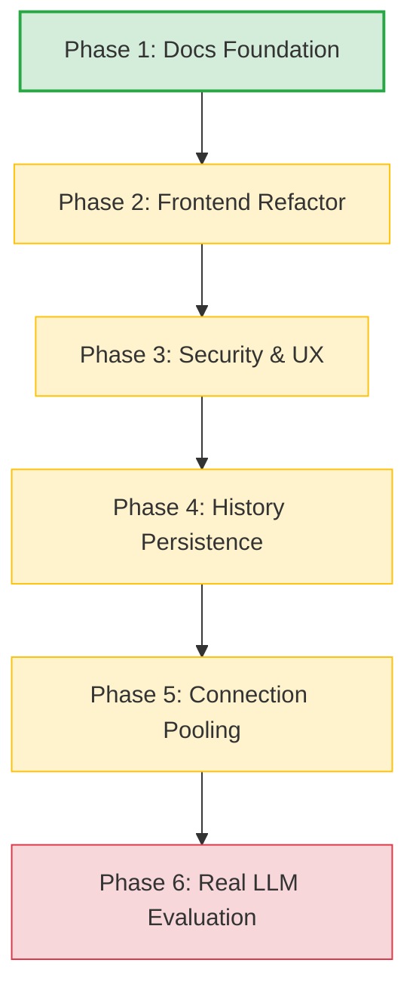

# Development Roadmap - Agent Evaluation Dashboard

This roadmap details the planned future phases to evolve the Agent Evaluation Dashboard from its current MVP state to a more robust, secure, and production-ready tool.

---

## 🗺️ Phase-by-Phase Roadmap

### Done: Phase 1 - Documentation Foundation
* Set up standard specification documents to guide subsequent steps.
* **Deliverables**:
  - `docs/API_SPEC.md`
  - `docs/ROADMAP.md`
  - `docs/DEVELOPMENT_LOG.md`

### Upcoming: Phase 2 - Frontend Refactoring (ES Modules)
* **Goal**: Solve the maintainability issue of `frontend/app.js` (~600 lines monolith) and reduce token usage for future AI agent runs.
* **Tasks**:
  - Convert index.html to load modular JS files via Native ES Modules (`type="module"`).
  - Create `frontend/js/api.js` for API requests.
  - Create `frontend/js/benchmarks.js` for simulated/real evaluation definitions.
  - Create `frontend/js/ui.js` for rendering code, chart, and event hooks.
  - Delete `frontend/app.js`.

### Upcoming: Phase 3 - Security & UX Enhancements
* **Goal**: Protect the application from XSS injections (especially since it renders repository files dynamically via MCP) and improve interface stability.
* **Tasks**:
  - Add native HTML sanitization when rendering stdout/file contents from MCP tools.
  - Implement basic fallback error boundaries in UI layout so a single network/API error doesn't lock up the browser interface.

### Upcoming: Phase 4 - History Persistence (JSON DB)
* **Goal**: Transition from ephemeral browser `localStorage` to local server-side history logs.
* **Tasks**:
  - Create a lightweight Python JSON-file database helper (e.g. storing runs in `data/eval_history.json`).
  - Expose `/api/history` endpoints to retrieve and post runs.
  - Connect the frontend to load and persist data across browser session clears.

### Upcoming: Phase 5 - Connection Pooling & Performance
* **Goal**: Eliminate subprocess initialization latency.
* **Tasks**:
  - Update `backend/server.py` to keep the MCP subprocesses running as persistent processes.
  - Dynamically parse and pass configurable command line options (like timeout values) from configuration.

### Future: Phase 6 - Real LLM & Judge Integration
* **Goal**: Move away from mocked evaluations and support actual AI evaluation workflows.
* **Tasks**:
  - Integrate official Gemini Developer SDK or standard LLM client.
  - Implement a real "Judge Model" evaluator (e.g., assessing hallucinations, test accuracy, style conformance).
  - Support configuring credentials in a safe local environment (`.env`).
